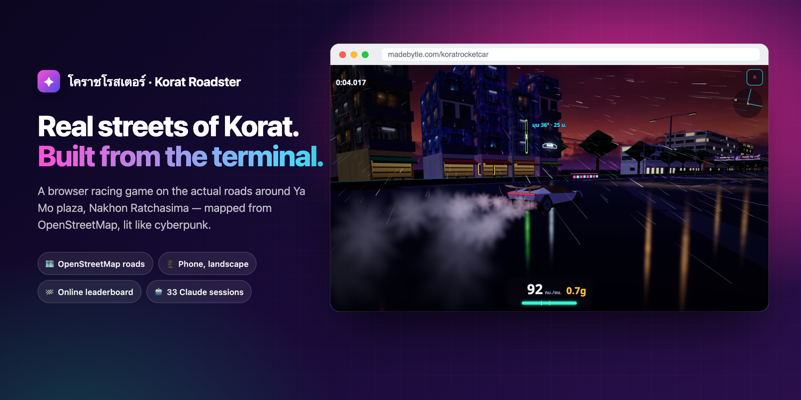
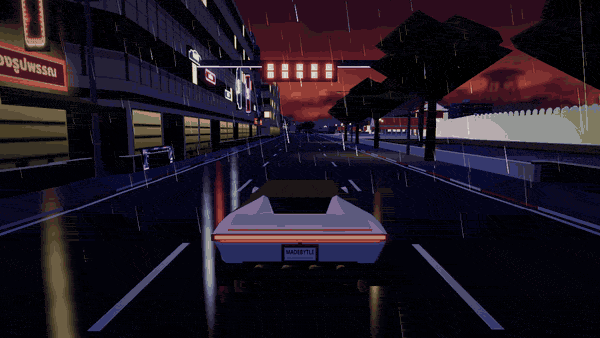
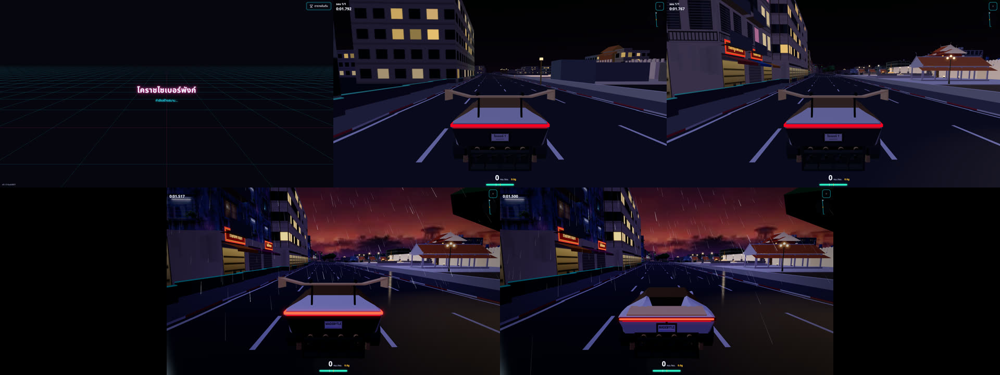

<div align="center">



# โคราชโรสเตอร์ · Korat Roadster

**A real-street racing game around Korat's Ya Mo plaza. Built entirely from the terminal.**

One lap of the old-city moat in Nakhon Ratchasima, Thailand — the road layout comes from OpenStreetMap,<br>
the night, rain and neon are made up. Plays in a phone browser, no install, no sign-up.

เกมแข่งรถบนถนนจริงรอบลานย่าโม โคราช · เล่นในเบราว์เซอร์มือถือ (จอแนวนอน) ไม่ต้องลงแอป ไม่ต้องสมัคร

[](https://threejs.org)
[](https://www.typescriptlang.org)
[](https://vite.dev)
[](https://vercel.com)
[](https://neon.tech)
[](https://www.openstreetmap.org/copyright)

### **[▶ Play it now — madebytle.com/koratrocketcar](https://madebytle.com/koratrocketcar)**

[What's in it](#-whats-in-it) · [See it](#-see-it-in-action) · [How it was built](#%EF%B8%8F-how-it-was-built) · [Real, not invented](#%EF%B8%8F-real-streets-not-invented-ones) · [Run it yourself](#-run-it-yourself) · [Credits](#-credits)

</div>

---

## ✨ What's in it

| Feature | What it does |
|---|---|
| 🗺️ **A real track** | 3,307 m race line traced from OpenStreetMap around the old-city moat: Ratchadamnoen → Ratchasima–Chok Chai (Route 224) → Manat → Sanphasit → Watcharasarit → Kamhaeng Songkhram. Max deviation from the map: 3.07 m. |
| 🛕 **Landmarks, treated with respect** | Thao Suranari (Ya Mo) monument and plaza, Chumphon Gate, the moat, Wat Sutthachinda. You race *past* the plaza — the monument is the best-lit thing in the scene and can't be hit. |
| 🚀 **A rocket roadster** | The **ราชสีห์ R1**, modelled in code (no imported 3D model), inspired by the newly announced Roadster: launch boost, a cold-gas jump, and a rear wing that folds away when parked and deploys above 80 km/h. |
| 💦 **Jump the moat** | A show-off jump across ~30 m of water on Manat Road. It's a trick, not a shortcut. |
| 🚧 **Joke checkpoints** | Two "alcohol checkpoints" to jump over — or plough through and watch cones (2.5 kg), signs (12 kg) and barriers (16 kg) fly by mass. No people, no real agency logos, a "don't drink and drive" sign. |
| 🌃 **Cyberpunk Korat** | Night, rain, wet roads reflecting neon. 297 neon shop signs in Thai (fictional names, rendered with a real font), 403 spans of power lines swaying in the wind and in the car's wake. |
| ↪️ **Thai-style turn warnings** | Yellow-black LED chevron signs before every corner plus a HUD arrow, so a first-time player knows where the road goes. |
| 🏁 **Online leaderboard + ghost** | Race first, name yourself only if you make the board. Race against the #1 ghost. No accounts — a device id in `localStorage`. |
| 📱 **Phone first** | Landscape touch controls, Thai-only UI, graceful errors (no WebGL, map failed to load, portrait mode, low fps → offer lower quality). Keyboard works on desktop. |

## 🎬 See it in action

<div align="center">

<br><sub>Launch boost → jumping the checkpoint → Manat Road neon. Recorded from the live site with the built-in demo mode.</sub>
</div>

### Controls

| Phone (landscape) | Keyboard | Action |
|---|---|---|
| ◀ ▶ (left thumb) | ← → / A D | Steer |
| ⏫ | ↑ / W | Throttle (auto-throttle is a toggle in settings) |
| ⏬ | ↓ / S | Brake / reverse |
| ⬆ circle | Space | Jump (shares the air tank with boost) |
| ⚡ | Shift | Boost |
| — | Esc / P · R · M | Pause · respawn · mute |

## 🛠️ How it was built

**One evening, one human, 33 Claude sessions, zero editors.** The game went from an empty folder (17 Oct 2026, 18:10) to production (18 Oct, 00:24) — about six hours — without opening a 3D tool, Photoshop or a code editor. Everything happened in the terminal.

- A **conductor** Claude Code session took instructions from Tle, split the work into written briefs (`docs/**/BRIEF-*.md`), and opened a new herdr tab per job, each running its own Claude Code. It reviewed every result, committed, and deployed — but never wrote game code itself.
- **32 worker panes** did the work, up to 7 at a time (plus the conductor). Every one ran **Claude Opus 5.5**.
- A dedicated **QA pane** owned a release gate (122 test cases, 77 blocking) and could say **NO-GO** — it did once, when the car bounced 5.9 m into the air off one barrier. Fixed to 0 m before shipping.
- Helpers outside the workspace: a ChatGPT (Codex) pane painted 20 text-free illustrations; Mint, another AI assistant, recorded the English announcer voice.

| Phase | Panes (a few of them) | Output |
|---|---|---|
| Research | 🔎 osm · 🔎 landmarks · 🔎 streetview · 🔎 car · 🔎 audio | `research/` |
| Design | 🎮 gameplay · 🧮 physics · 🧪 qa | `docs/dev/GAMEPLAY.md`, `docs/dev/PHYSICS.md`, `docs/qa/` |
| M1 — drivable slice | 🛣️ world · 🚗 car-model · 🧮 car-physics · 🎮 game-ui · 🔊 audio-dev · ⚙️ backend | `src/track/`, `src/car/`, `src/game/`, `api/` |
| M2 — the city | 🏛️ landmarks-3d · 🏘️ streetscape | `src/track/landmarks/` |
| M3 — cyberpunk | 🌃 visuals · 💨 fx · 🖼️ art · 🏁 sponsors · 🚧 checkpoint · 🔰 wayfinding · 🐞 fix | `src/scene/`, `src/neon/`, `src/fx/`, … |
| Ship | 🧪 qa-m3 · 🌐 madebytle · 🔧 polish · 🎬 clips | `docs/qa/reports/`, `src/capture/` |

<div align="center">

<br><sub>Same street, same camera, five builds from git: 18:40 empty grid · 19:40 M1 · 20:08 M2 · 21:35 M3 · 01:11 v0.3.0</sub>
</div>

The full timeline of every pane is in [`promo/PANES.md`](promo/PANES.md); the minute-by-minute log is [`docs/making-of/LOG.md`](docs/making-of/LOG.md).

## 🗺️ Real streets, not invented ones

The rule for this project: **truth before beauty.** If cyberpunk wants a 40-storey tower where Korat has a 3-storey shophouse, the shophouse stays and gets neon instead.

| Source | Used for | Not used for |
|---|---|---|
| **OpenStreetMap** (ODbL) | Road centrelines, lanes, the moat, building footprints → converted by `scripts/` into `public/data/` | — |
| **Google Street View** | Looking only: two virtual walks of the circuit (44 segments, then 37 points around the lap) to check colours, sign positions, building heights | ❌ No Google imagery, textures or geometry is in the game or this repo |
| **Wikimedia Commons** | 30 CC-licensed reference photos of landmarks, each credited | — |
| **Launch coverage of the new Roadster** | Proportions and abilities of the car (reference only) | ❌ No news photos in the game; no Tesla name or logo |

Street View caught the map out more than once: OSM labels the road along the north moat "Mittraphap" (it's Ratchasima–Chok Chai), and a 148° hairpin in the map data doesn't exist — the real corner is a ~95° right turn through a big intersection. The game follows the street, not the map.

## ⚙️ Physics

Arcade, but every number is derived from something real (`docs/dev/PHYSICS.md`, `src/car/physics*.ts`):

- **Launch:** 4.63 g, 0–100 km/h in 0.63 s — *computed in-game from launch-press specs, not a manufacturer figure.*
- **Jump:** cold-gas thrusters. The white plume is condensation: expanding gas cools to about −183 °C and meets humid air. It's vapour, not fire.
- When the press numbers contradicted each other ("80 kN" and "a 5–6 s burn" can't both be true), the physics pane picked the physically possible value and wrote down why.
- Fixed 120 Hz physics step, raycast-vehicle model tuned for NFS-style drifting. The signature corner is a 93° right-hand drift into Route 224.

## 🧰 Tech stack

| Layer | Used |
|---|---|
| Rendering | three.js (WebGL2) + bloom, water shader for the moat |
| Language / build | TypeScript · Vite · pnpm |
| Physics | Hand-written arcade raycast vehicle |
| Map pipeline | Overpass (OSM) → `scripts/` → JSON in metres from the monument |
| Leaderboard | Vercel Functions (`api/`) · Neon Postgres · Drizzle ORM |
| UI | HTML overlay · Noto Sans Thai · Heroicons |
| Testing | Playwright (`tests/`) |
| Hosting | Vercel, proxied at `madebytle.com/koratrocketcar` |

## 🏃 Run it yourself

```bash
pnpm i
pnpm dev          # http://localhost:5173/koratrocketcar/
pnpm typecheck
pnpm build && pnpm preview
```

The game itself needs no keys — OSM data is already processed into `public/data/`. The **online leaderboard** lives in Vercel Functions and needs two variables in `.env.local` (pull them with `vercel env pull` on a linked Vercel project — `.env.example` lists no required keys because the game runs without them):

| Variable | Used by |
|---|---|
| `DATABASE_URL` | `db/client.ts` — Neon Postgres |
| `RUN_TOKEN_SECRET` | `api/_lib/http.ts` — signs race tokens (≥ 32 chars) |

### Demo / capture mode

Any build can play a scripted, frame-deterministic shot from the URL — that's how the GIF above was made:

```
https://madebytle.com/koratrocketcar/?demo=1&shot=great-jump&hud=1
node scripts/record-demo.mjs --shot drift --hud 0 --width 1280 --height 720
```

17 shots are listed in [`promo/SHOTLIST.md`](promo/SHOTLIST.md). Demo runs never post scores.

## 🙏 Credits

- Map data © [OpenStreetMap contributors](https://www.openstreetmap.org/copyright) (ODbL)
- Photos, audio, logos and their licences: [`research/CREDITS.md`](research/CREDITS.md) and [`promo/CREDITS.md`](promo/CREDITS.md)
- Announcer voice: ElevenLabs (free plan, non-commercial) · SFX/music: Kenney, OpenGameArt, Freesound (CC0)
- In-game sponsors: MADEBYTLE and the Nakhon Ratchasima Digital Association (logos used with permission)

## License

Code © Tle ([madebytle](https://madebytle.com)) — all rights reserved for now.
Assets keep their own licenses (see [`research/CREDITS.md`](research/CREDITS.md)).
Not affiliated with Tesla, Inc. — the car is inspired by the Tesla Roadster (2026).

<div align="center">
<br>
<b>If a racing game on the streets of Korat made you smile, a ⭐ helps others find it.</b>
<br><sub>Made by <a href="https://madebytle.com">Tle</a> with Claude Code · โคราช 🇹🇭</sub>
</div>
