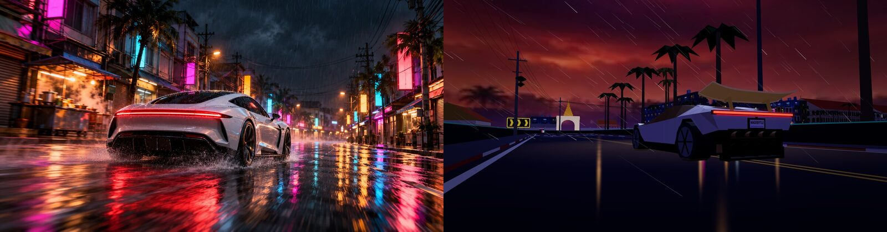
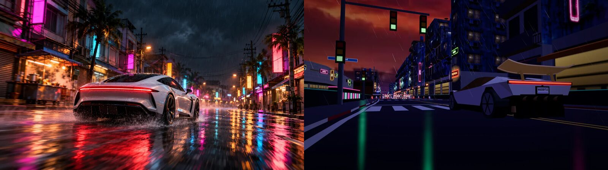
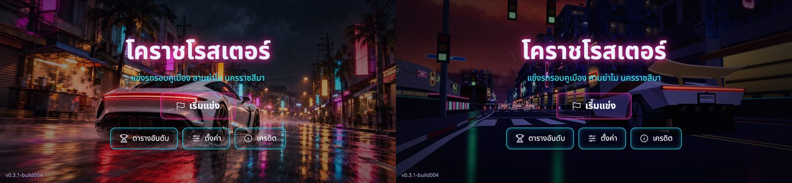
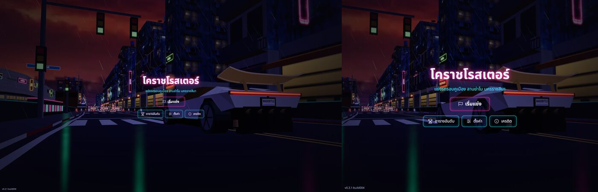

# REPORT — ภาพหน้าโหลด + OG ใหม่จากโมเดล R1 ในเกม · รอบ 2 · 2026-10-18 05:35

**สรุป:** แก้ตามที่ conductor ตีกลับครบ 4 ข้อแล้ว ✅ (ชื่อไฟล์/ขนาดเดิม · typecheck ✅ build ✅ · ไม่ bump version · ไม่ commit/push/deploy)
1. **เห็นรถเต็มคันทุกไฟล์:** cover รถอยู่ x 47–89% · og อยู่ x 43–79% · ไม่มีส่วนไหนเลยขอบ · เช็คหน้าเมนูจริงที่ 844×390, 1920×1080, 1280×800, 1024×768 (4:3) แล้วเห็นรถเต็มคันทุกจอ
2. **ขนาด/มุม:** รถกินความกว้างภาพ cover ~41% · og ~36% · มุมหลังเฉียง 3/4 กล้องสูง 0.55 ม. (เดิม 0.8) · ไฟท้ายแดง + ป้าย MADEBYTLE อ่านออก
3. **วางรถ:** cover อยู่ครึ่งขวา ไม่ทับชื่อเกมกับปุ่ม (บนจอมือถือ 2.16:1 ปุ่มทับแค่ล้อซ้าย) · og อยู่กลาง-ขวา
4. **แลนด์มาร์ก:** og = ถนนกำแหงสงคราม (track ≈ 2,900 ม.) ไกล ๆ เป็น **ซุ้มประตูวัดสุทธจินดา** (ยอดทอง) + ต้นตาล + ป้ายบั้งเหลือง · cover = ถนนมนัสสายนีออนเดิม (≈ 1,720 ม.) เพราะแลนด์มาร์กจะไปอยู่หลังชื่อเกม/ปุ่มกลางจอพอดี · ลองประตูชุมพล/ซุ้มประตูเมืองมุมตะวันตกเฉียงเหนือแล้ว ทั้งคู่อยู่ฝั่งขวาของถนน ถ้าจะให้เห็นต้องวางรถไว้ซ้าย เลยไม่ใช้
- โค้ด: `src/capture/shots.ts` มี 2 shot `cover` กับ `og-cover` (og เรนเดอร์ที่ viewport 1200×630) ใช้กล้องเดียวกัน ปรับได้ทาง URL (`coverS/Kmh/Right/Up/Fwd/LookFwd/LookUp/Fov/Yaw/Pitch`) · เรนเดอร์ DPR 2 แล้วย่อ Lanczos · วิ่ง 25 กม./ชม. เพื่อไม่ให้ละอองน้ำล้อบังท้ายรถ
- `src/scene/visuals.ts`: จุดยึดภาพหน้าโหลดเปลี่ยนจาก `center` เป็น `80% 50%` (บรรทัดเดียว) → จอที่แคบกว่า 16:9 (iPad 4:3) จะครอปฝั่งซ้าย ไม่ไปตัดรถ · จอที่กว้างกว่า 16:9 ไม่มีผล
- ขนาดไฟล์: cover-1920 96 KB · cover-1280 56 KB · og 70 KB (≤ 300 ✅) · `og:image:alt` + `art-manifest.json` อัปเดตแล้ว
- ข้อจำกัด: จอแนวตั้งจะครอปรถออก แต่จอแนวตั้งแสดงหน้า "หมุนจอ" อยู่แล้ว · หลัง deploy ต้องกด Scrape Again ที่ Facebook Sharing Debugger เพราะ FB/LINE cache ภาพเดิม
- dev server (5233) ปิดแล้ว ลบสคริปต์ชั่วคราวแล้ว · ไฟล์ `src/car/*`, `engine.ts`, `input/index.ts` ที่ขึ้นว่าแก้ใน git status เป็นงานของ pane wobble ไม่ใช่งานนี้

## ภาพเทียบ (ซ้าย = เดิม · ขวา = รอบ 2)

OG 1200×630 (เดิม = imagegen)

ภาพหน้าโหลด cover 16:9

หน้าเมนู 844×390 (มือถือแนวนอน)

หน้าเมนู 1920×1080 · 1024×768 (4:3)

## ไฟล์ของงานนี้ (add เฉพาะชุดนี้)
`public/assets/img/cover-1920x1080.webp` · `cover-1280x720.webp` · `og-cover-1200x630.jpg` · `index.html` · `src/capture/shots.ts` · `src/scene/visuals.ts` · `docs/dev/m3/art-manifest.json` · `docs/dev/hotfix/img/*` · `docs/dev/hotfix/REPORT-cover-from-r1.md` (+ BRIEF)
